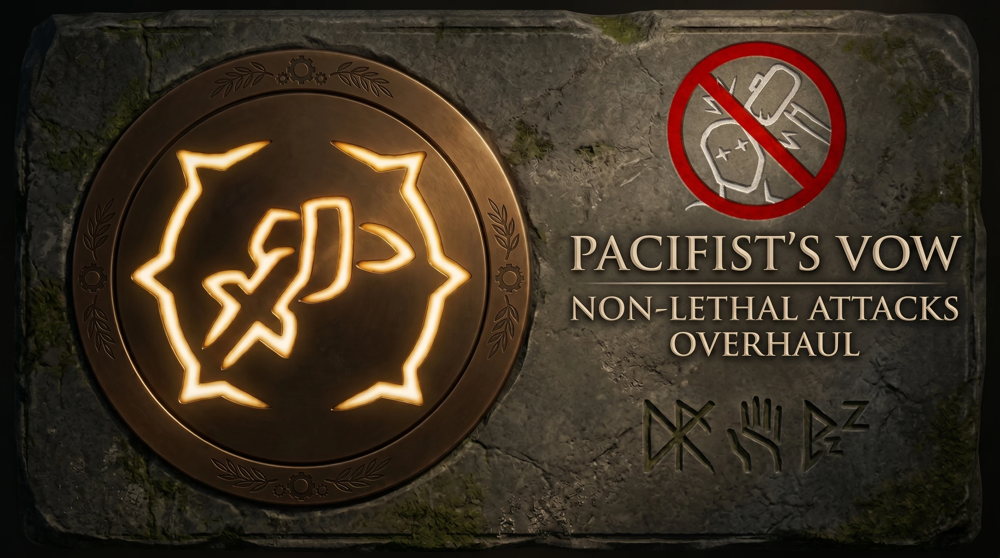
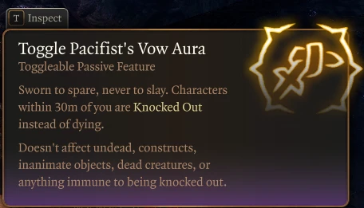
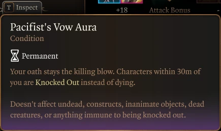
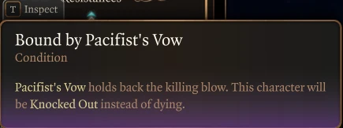

# Pacifist's Vow - Non-Lethal Attacks Overhaul

A toggleable 30m non-lethal aura for Baldur's Gate 3 that turns every killing blow inside its range into a clean Knock Out. Works with melee, ranged, and spells.

**[Download on Nexus Mods](https://www.nexusmods.com/baldursgate3/mods/22813)**

This mod merges two existing mods into a standalone overhaul:

- **Bonk Enhanced** by BaldursGoonsack — 30m aura model, per-character toggle, eligibility filters.
- **Auto-Knockout Story NPCs** by whatsontheflip — direct Knock Out approach (no Downed saving throw flicker).

## Features

- Replaces the vanilla Non-Lethal Attacks toggle with a 30m aura.
- Any character inside the aura that would die instead drops to 1 HP and gains the Knocked Out status directly.
- No Downed saving throws, no death-save flicker, no Damage Over Time breaking the chain.
- Per-character toggle. Each party member controls their own aura.
- Affects everything in range: melee, ranged, spells, AoE, environmental damage.
- XP is still granted on Knock Out.
- Toggle it off and combat returns to fully lethal as normal.
- Vanilla restrictions preserved (undead, constructs, spore servants, inanimate objects, dead creatures, anything immune to KO). Quest-critical NPCs stay on the standard restriction list.

See the aura and status tooltips in game

## Versions

Two editions are included. Install only one at a time — they share a UUID and act as drop-in replacements for each other.

- **`Pacifist's Vow - Non-Lethal Attacks Overhaul/`** — main edition. Uses the Legendary Action: Ptarian Dogma "pacifying aura" icon for the aura statuses.
- **`Pacifist's Vow - Non-Lethal Attacks Overhaul (Original Icons)/`** — variant. Uses the vanilla `Action_KnockOut` icon, matching the Bonk Enhanced visual style.

## Requirements

- [BG3 Script Extender](https://github.com/Norbyte/bg3se)

## Installation

1. Download your chosen edition as a `.pak` from [Nexus Mods](https://www.nexusmods.com/baldursgate3/mods/22813?tab=files). To build from this repository, pack the edition's folder with [BG3 Modders Multitool](https://github.com/ShinyHobo/BG3-Modders-Multitool) or LSLib.
2. Drop the `.pak` into `%LOCALAPPDATA%\Larian Studios\Baldur's Gate 3\Mods\`, or install through BG3 Mod Manager / Vortex.
3. Load Pacifist's Vow below any other mod that modifies the `NonLethal` passive or `NON_LETHAL` status.

## Compatibility

**Conflicts with:**

- **Non-Lethal Ranged Attacks and Spells** — Pacifist's Vow already covers ranged and spells natively.
- **Bonk Enhanced - Knocked Out Failsafe - Non-Lethal Attacks and Damage Overhaul** — Pacifist's Vow is built on top of it and overrides the same entries.

**Plays nicely with:**

- **Auto-Knockout Story NPCs** — fully compatible. That mod continues protecting story-critical NPCs from dying even when the Pacifist's Vow aura is toggled off.

## Credits

- [BaldursGoonsack](https://next.nexusmods.com/profile/BaldursGoonsack) for **Bonk Enhanced**, whose aura model and eligibility filters power the targeting half of this mod.
- [whatsontheflip](https://next.nexusmods.com/profile/whatsontheflip) for **Auto-Knockout Story NPCs**, whose direct Knock Out approach inspired the Script Extender hook used here.

Released under the terms permitted by BaldursGoonsack's GBBL (Goonsack BG3 Bonk License).

## License

See [LICENSE.md](./LICENSE.md).
